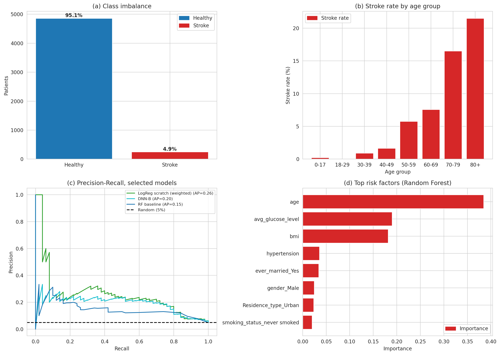

# سامانه‌ی هشدار زودهنگام سکته‌ی مغزی

*[English version](README.md)*

ایده این پروژه این است که بیمارستان بتواند در مراجعات عادی، فقط با چند فیلد ساده‌ی
پرونده (سن، فشار خون، بیماری قلبی، قند خون، شاخص توده‌ی بدنی، وضعیت سیگار و ...) بیمارانی را که در خطر بالای سکته‌اند
علامت‌گذاری کند تا پزشک زودتر آن‌ها را ببیند.

مشکل اصلی خود داده است. از ۵۱۱۰ بیمار فقط حدود ۵٪ سکته کرده‌اند. مدلی که همیشه بگوید «سکته نمی‌کند» حدود ۹۵٪
دقت می‌گیرد و هیچ بیماری را پیدا نمی‌کند. بخش بزرگی از پروژه صرف دور زدن همین مشکل شد.



## چه کارهایی انجام شد

کل تحلیل در یک نوت‌بوک است: [`stroke_early_warning.ipynb`](stroke_early_warning.ipynb) (فارسی، با کامنت روی کدها).

۱. پاک‌سازی داده: مقادیر گمشده‌ی BMI، مقادیر پرت و وضعیت `Unknown` در ستون سیگار
۲. تحلیل اکتشافی
۳. آماده‌سازی داده بدون نشت اطلاعات (میانه و مقیاس‌دهی فقط روی داده‌ی آموزش یاد گرفته می‌شوند)
۴. مدل پایه: Random Forest بدون هیچ اصلاحی
۵. رگرسیون لجستیک از صفر با NumPy (سیگموید، Cross-Entropy، گرادیان کاهشی و نسخه‌ی وزن‌دار) و مقایسه با scikit-learn
۶. وزن‌دهی کلاس‌ها، SMOTE و Undersampling روی Random Forest
۷. دو شبکه‌ی کوچک Keras با Dropout و EarlyStopping
۸. مقایسه‌ی نهایی: منحنی ROC و Precision-Recall، آستانه‌ی تصمیم، هزینه‌ی بیمار از دست‌رفته در برابر هشدار اشتباه،
   اهمیت ویژگی‌ها

## نتایج

داده‌ی آزمون: ۱۰۲۲ بیمار که ۵۰ نفرشان سکته کرده‌اند. آستانه‌ی ۰٫۵.

| مدل | Accuracy | Precision | Recall | F1 | AUC |
|---|---|---|---|---|---|
| Random Forest (پایه) | 0.950 | 0.000 | 0.00 | 0.000 | 0.791 |
| Random Forest + وزن کلاس‌ها | 0.950 | 0.000 | 0.00 | 0.000 | 0.781 |
| Random Forest + SMOTE | 0.934 | 0.207 | 0.12 | 0.152 | 0.763 |
| Random Forest + Undersampling | 0.660 | 0.106 | 0.80 | 0.187 | 0.806 |
| رگرسیون لجستیک دست‌ساز، بدون وزن | 0.952 | 1.000 | 0.02 | 0.039 | 0.839 |
| رگرسیون لجستیک دست‌ساز، وزن‌دار | 0.739 | 0.135 | 0.80 | 0.231 | 0.840 |
| رگرسیون لجستیک scikit-learn، balanced | 0.739 | 0.135 | 0.80 | 0.231 | 0.840 |
| شبکه‌ی Keras نوع A | 0.679 | 0.114 | 0.82 | 0.200 | 0.816 |
| شبکه‌ی Keras نوع B | 0.657 | 0.109 | 0.84 | 0.193 | 0.829 |

(جدول کامل در [`results/model_comparison.csv`](results/model_comparison.csv) است.)

چیزهایی که از نتایج یاد گرفتم:

- **Accuracy اینجا بی‌معناست.** جنگل تصادفی پایه ۹۵٪ دقت دارد ولی Recall آن صفر است و هیچ بیماری را پیدا نمی‌کند.
- **رگرسیون لجستیک وزن‌دار انتخاب من است.** از ۵۰ بیمار، ۴۰ نفر را پیدا می‌کند (Recall برابر ۰٫۸۰) و ۲۵۷ هشدار
  اشتباه می‌دهد. شبکه‌های عصبی و جنگل‌ها در این داده‌ی جدولیِ کوچک بهتر نبودند و لجستیک را راحت‌تر می‌شود توضیح داد.
  نسخه‌ی دست‌ساز من تقریباً همان ضرایب scikit-learn را می‌دهد.
- **Precision پایین است (حدود ۱۳٪).** برای پیدا کردن بیشتر بیماران باید تعداد زیادی آدم سالم هم علامت بخورند. فکر می‌کنم
  برای یک ابزار غربالگری قابل‌قبول است، چون از دست رفتن یک بیمار خیلی گران‌تر از یک معاینه‌ی اضافی است؛ ولی بار کاری
  اضافه باید پیش‌بینی شود.
- **سن با اختلاف زیاد مهم‌ترین عامل است**، بعدش بیماری قلبی، قند خون و فشار خون. بعضی چیزها که مهم به‌نظر می‌رسند، مثل
  «سیگاری سابق» یا «ازدواج کرده»، بیشتر انعکاس سن‌اند.

## محدودیت‌ها

- در کل حدود ۲۵۰ مورد سکته داریم و فقط ۵۰ مورد در داده‌ی آزمون هست؛ پس اعداد ناپایدارند. یک bootstrap سریع روی داده‌ی آزمون
  Recall مدل انتخابی را تقریباً بین ۰٫۶۹ تا ۰٫۹۱ نشان می‌دهد.
- دیتاست عمومی است و منبعش معلوم نیست. ممکن است برای بیمارستان دیگری درست کار نکند.
- عوامل خطر مفیدی مثل کلسترول، فیبریلاسیون دهلیزی و سابقه‌ی خانوادگی در داده نیست.
- نسبت هزینه‌ای که برای بحث آستانه استفاده کردم (از دست رفتن یک بیمار ۵۰ برابر هشدار اشتباه) یک فرض است؛ عدد واقعی را
  باید پزشکان بدهند.
- SMOTE دست‌ساز من در ستون‌های صفر و یک مقدار اعشاری می‌سازد. SMOTENC این کار را بهتر انجام می‌دهد.

## اجرا

```bash
pip install -r requirements.txt
```

دیتاست را در پوشه‌ی `data/` بگذارید ([`data/README.md`](data/README.md))، بعد نوت‌بوک را باز کنید و همه‌ی سلول‌ها را اجرا کنید.
نصب TensorFlow سنگین است؛ اگر مشکل داشت، نوت‌بوک روی Google Colab هم اجرا می‌شود (فایل CSV را آپلود می‌کنید).
seedها ثابت‌اند (۴۲) ولی نتایج Keras ممکن است روی دستگاه‌های مختلف کمی فرق کند.

```
stroke_early_warning.ipynb   تحلیل کامل (با خروجی‌ها)
results/                     نمودارها و جدول نتایج
data/                        فایل CSV را اینجا بگذارید
```

## هشدار

این یک پروژه‌ی آموزشی است. ابزار پزشکی نیست و نباید برای تصمیم‌های بالینی واقعی استفاده شود.

## مجوز

MIT، فایل [LICENSE](LICENSE).
