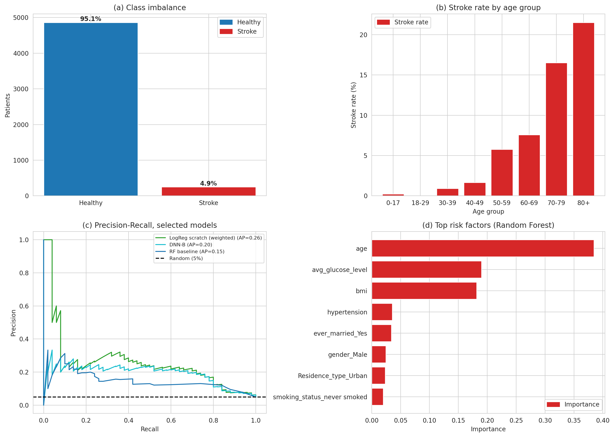

# Stroke Early-Warning System

*[نسخه‌ی فارسی](README.fa.md)*

I built this for a machine learning course. The idea: a hospital wants to flag patients who are at high risk of
stroke during routine visits, using only a few fields from their record (age, hypertension, heart disease,
glucose, BMI, smoking status...), so a doctor can look at them sooner.

The hard part is the data. Only about 5% of the 5110 patients in the dataset had a stroke, so a model that
always says "no stroke" gets ~95% accuracy and finds nobody. Most of this project is about getting around that.



## What I did

The whole analysis is in one notebook, [`stroke_early_warning.ipynb`](stroke_early_warning.ipynb) (written in Persian,
with comments on the code):

1. Cleaning the data: missing BMI values, outliers, and the `Unknown` smoking status
2. Exploratory analysis
3. Preparing the data without leakage (the median and the scaler are learned on the training set only)
4. A Random Forest baseline with no corrections
5. Logistic regression written from scratch with NumPy (sigmoid, cross-entropy, gradient descent, a class-weighted
   version) and checked against scikit-learn
6. Class weights, SMOTE and undersampling on the Random Forest
7. Two small Keras networks with Dropout and EarlyStopping
8. Final comparison: ROC and precision-recall curves, decision threshold, cost of a missed patient vs a false alarm,
   feature importance

## Results

Test set: 1022 patients, 50 of them with a stroke. Threshold 0.5.

| Model | Accuracy | Precision | Recall | F1 | AUC |
|---|---|---|---|---|---|
| Random Forest (baseline) | 0.950 | 0.000 | 0.00 | 0.000 | 0.791 |
| Random Forest + class weights | 0.950 | 0.000 | 0.00 | 0.000 | 0.781 |
| Random Forest + SMOTE | 0.934 | 0.207 | 0.12 | 0.152 | 0.763 |
| Random Forest + undersampling | 0.660 | 0.106 | 0.80 | 0.187 | 0.806 |
| Logistic regression, from scratch, no weights | 0.952 | 1.000 | 0.02 | 0.039 | 0.839 |
| Logistic regression, from scratch, weighted | 0.739 | 0.135 | 0.80 | 0.231 | 0.840 |
| Logistic regression, scikit-learn, balanced | 0.739 | 0.135 | 0.80 | 0.231 | 0.840 |
| Keras network A | 0.679 | 0.114 | 0.82 | 0.200 | 0.816 |
| Keras network B | 0.657 | 0.109 | 0.84 | 0.193 | 0.829 |

(The full table is in [`results/model_comparison.csv`](results/model_comparison.csv).)

What I took from it:

- **Accuracy is useless here.** The baseline forest has 95% accuracy and a recall of 0: it never finds a patient.
- **The weighted logistic regression is my pick.** It finds 40 of the 50 patients (recall 0.80) with 257 false
  alarms. The neural networks and the forests didn't do better on this small tabular dataset, and logistic regression
  is easy to explain. My hand-written version ends up with practically the same coefficients as scikit-learn's.
- **Precision is low (about 13%).** To catch most patients you have to flag a lot of healthy people. I think that's
  acceptable for a screening tool, because a missed patient costs far more than an extra check-up, but the extra
  workload would need to be planned for.
- **Age is by far the strongest factor**, followed by heart disease, glucose and hypertension. Some things that look
  important, like "former smoker" or "ever married", mostly just reflect age.

## Limitations

- There are only about 250 stroke cases in total and 50 in the test set, so the numbers are shaky. A quick bootstrap
  on the test set puts recall for the chosen model somewhere around 0.69-0.91.
- It's a public dataset from an unknown source. It might not carry over to another hospital.
- Useful risk factors (cholesterol, atrial fibrillation, family history) are missing.
- The cost ratio I used to talk about thresholds (a missed patient costs 50 times a false alarm) is an assumption.
  Real numbers would have to come from doctors.
- My SMOTE creates fractional values in the 0/1 columns. SMOTENC would handle that better.

## Running it

```bash
pip install -r requirements.txt
```

Download the dataset into `data/` (see [`data/README.md`](data/README.md)), then open the notebook and run all cells.
TensorFlow is a big install; if that's a problem, the notebook also runs on Google Colab (it asks you to upload the CSV).
Random seeds are fixed (42), but the Keras results can differ a little between machines.

```
stroke_early_warning.ipynb   the analysis (with outputs)
results/                     figures and the results table
data/                        put the CSV here
```

## Disclaimer

This is a learning project. It is not a medical device and shouldn't be used for real clinical decisions.

## License

MIT, see [LICENSE](LICENSE).
